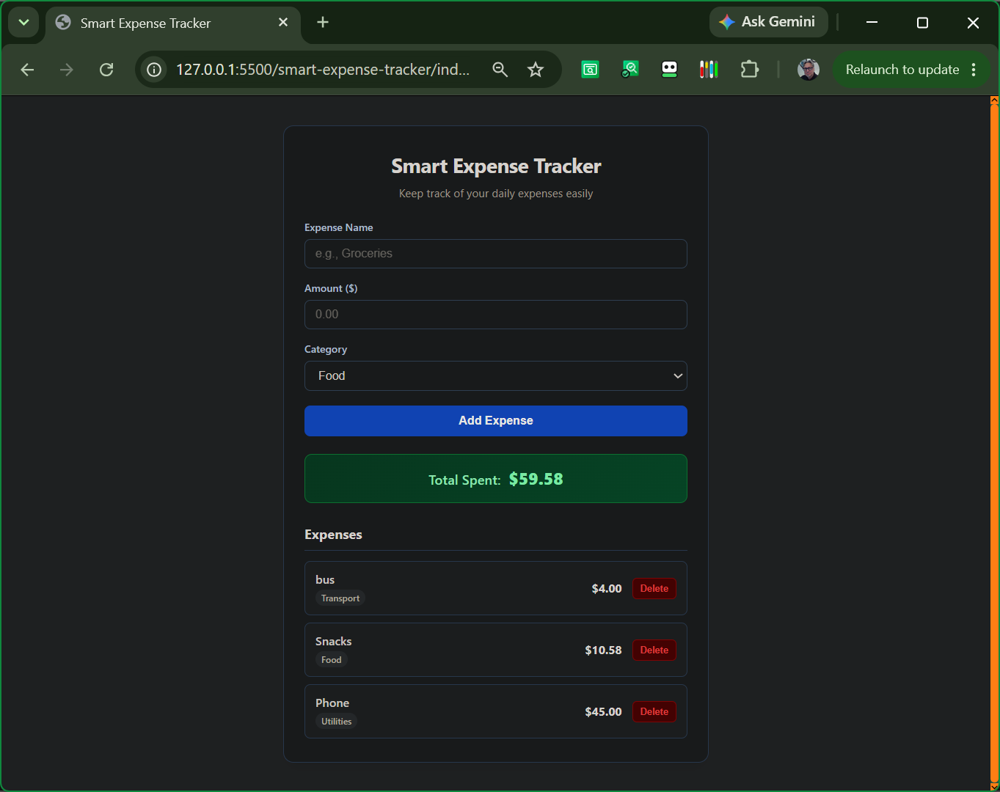
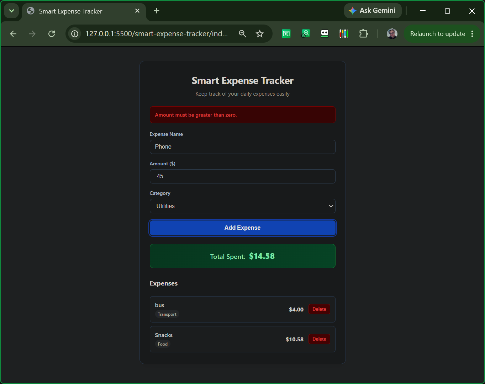
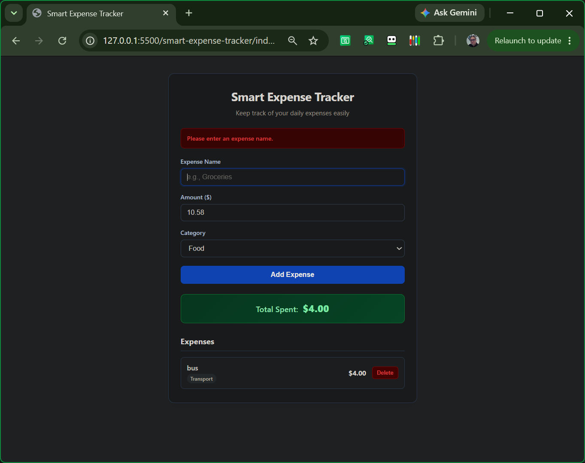
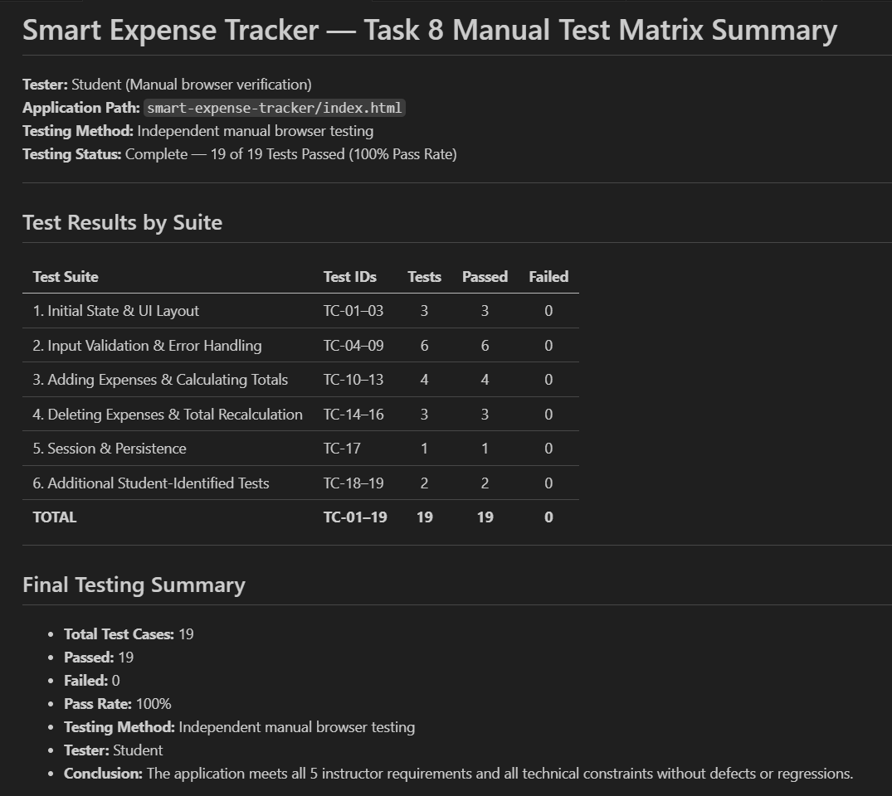

# Smart Expense Tracker

A simple, responsive single-page web application developed as part of the **CICD AI Vibe Coding Bootcamp** (Module 05: "Prompting for Development"). The application allows users to record, categorize, track, and manage daily personal expenses with real-time total calculation and input validation.

Developed with AI assistance via **Antigravity / Gemini** ("Aggi"), this project emphasizes structured prompt engineering, task decomposition, prompt chaining, manual testing, and code review refactoring.

---

## 1. Project Overview

* **Purpose:** Enable users to log personal expenditures with immediate feedback, categorized grouping, and dynamic calculation of total spending.
* **Technology Stack:** Pure client-side web technologies — **HTML5**, **plain CSS**, and **vanilla JavaScript** (ES6+).
* **Architecture:** In-memory state array (`expenses = []`) with zero external frameworks, libraries, build tools, or server-side dependencies. Data resets cleanly upon page reload per assignment specifications.

---

## 2. Assignment Requirements

The application fulfills all five required features defined by the instructor:

- [x] **Add an Expense:** Users can add an expense with a name, numeric amount, and category.
- [x] **Display Expenses:** Entered expenses appear dynamically in an organized list showing name, category tag, formatted amount, and an individual delete button.
- [x] **Calculate Total Spent:** Grand total spending updates automatically as expenses are added or removed, formatted in standard USD currency (`$0.00`).
- [x] **Delete an Expense:** Users can remove any individual expense row immediately with automatic total recalculation.
- [x] **Input Validation & Error Messages:** Form submission validates user input and displays friendly, targeted error messages for empty names, whitespace-only entries, missing amounts, zero amounts, and negative values.

### Implementation Decisions (Approved Project Choices)
* **Predefined Categories:** `Food`, `Transport`, `Housing`, `Entertainment`, `Utilities`, and `Other`.
* **Sequential Identifiers:** Simple incrementing integer IDs (`1, 2, 3...`) for item tracking.
* **Immediate Deletion:** Instant removal on button click without blocking modal dialogs.
* **Precision Safeguard:** Integer cent-based arithmetic (`Math.round(amount * 100)`) preventing binary floating-point rounding errors (e.g., `$0.01 + $0.02 = $0.03`).
* **XSS Defense:** Safe DOM text injection (`.textContent`) preventing arbitrary HTML execution.

---

## 3. Application Screenshots

### Main Interface & Expense List

*Figure 1: Active application displaying multiple categorized expenses and the cumulative total spent.*

### Negative Amount Validation

*Figure 2: Form validation rejecting a negative amount with the error message "Amount must be greater than zero."*

### Empty Name Validation

*Figure 3: Form validation rejecting an empty expense name with an active focus ring and the error message "Please enter an expense name."*

### Manual Test Suite Summary

*Figure 4: Summary of student manual testing results across all six test suites confirming a 100% pass rate.*

---

## 4. AI-Assisted Development Process

The application was built systematically through an iterative, pair-programming workflow with Antigravity / Gemini:

1. **Seven-Ingredient Structured Prompting:** Every prompt explicitly provided *Role, Context, Task, Constraints, Examples, Output Format,* and *Success Criteria*.
2. **Task Decomposition:** The project was divided into small, testable sequential milestones:
   * Task 1: Semantic HTML Skeleton (`index.html`)
   * Task 2: Base UI Styling & Layout (`style.css`)
   * Task 3: JavaScript State Setup & DOM Selectors (`app.js`)
   * Task 4: Input Validation & Error Handling
   * Task 5: Expense Addition & Total Calculation
   * Task 6: Dynamic Expense List Rendering & Security
   * Task 7: Individual Expense Deletion via Event Delegation
   * Task 8: End-to-End Testing, Code Review, and Refactoring
3. **Prompt Chaining:** Each completed milestone served as verified, unambiguous context for subsequent prompts.
4. **Execution Gates:** Strict constraints prevented the AI from writing premature code or claiming unverified test results without manual student verification.

> Complete verbatim records of all 18 prompts, outcomes, and prompt-chaining diagrams are documented in [PROMPT_HISTORY.md](PROMPT_HISTORY.md).

---

## 5. Testing & Verification

All application features, boundary cases, and error handlers were independently verified through manual browser testing.

| Metric | Result |
| :--- | :--- |
| **Initial Manual Tests** | **19 of 19 Passed** (100%) |
| **Post-Refactoring Regression Tests** | **7 of 7 Passed** (100%) |
| **Failed Tests** | **0** |
| **Testing Methodology** | Independent manual browser testing by student |

### Test Coverage Highlights
* **Happy Paths:** Single and cumulative expense additions across multiple categories.
* **Validation & Error Handling:** Empty names, whitespace-only names, empty amounts, zero amounts, and negative values.
* **Precision & Edge Cases:** Floating-point arithmetic validation (`$0.01 + $0.02 = $0.03`), sub-dollar decimal entry (`.3` formatting to `$0.30`), and leading whitespace trimming.
* **Security:** Plaintext rendering of HTML tags (`<b>...</b>`) verifying defense against Cross-Site Scripting (XSS).
* **Deletion & Empty State:** Individual item removal, cumulative total deductions, and restoration of the *"No expenses added yet"* placeholder upon deleting all items.

> * For a quick test suite breakdown, see [TEST_RESULTS_SUMMARY.md](TEST_RESULTS_SUMMARY.md).
> * For the full 19-case test matrix with steps and observed results, see [TEST_MATRIX.md](TEST_MATRIX.md).

---

## 6. Code Review & Improvement

Following successful verification of the core application, an AI-assisted code review was conducted to evaluate maintainability and code quality.

* **Identified Issue (Finding F-01):** Currency string formatting (`$${value.toFixed(2)}`) was duplicated in two separate locations: inside `updateTotalDisplay()` and inside the row-generation loop of `renderExpenses()`.
* **Implemented Refactoring:** Extracted the formatting logic into a single, pure helper function:
  ```javascript
  function formatCurrency(amount) {
    return `$${amount.toFixed(2)}`;
  }
  ```
* **Benefit (DRY Principle):** Establishes a Single Source of Truth for currency display across the interface, improving maintainability without modifying application behavior.
* **Regression Verification:** All 7 targeted regression tests (TC-01, TC-10, TC-11, TC-12, TC-14, TC-15, TC-19) passed with zero defects.

> Full before-and-after code diffs, engineering concepts, and regression test logs are documented in [CODE_REVIEW_IMPROVEMENT.md](CODE_REVIEW_IMPROVEMENT.md).

---

## 7. Project Files & Documentation

| File | Purpose |
| :--- | :--- |
| [index.html](index.html) | Semantic HTML5 structure, accessible form controls, and live region error container. |
| [style.css](style.css) | Custom vanilla CSS styling, card layout, focus indicators, and mobile responsive rules. |
| [app.js](app.js) | Application state, input validation, cent-safe calculation, DOM rendering, and deletion logic. |
| [ASSIGNMENT_REQUIREMENTS.md](ASSIGNMENT_REQUIREMENTS.md) | Authoritative reference of instructor requirements, technical constraints, and project choices. |
| [TEST_RESULTS_SUMMARY.md](TEST_RESULTS_SUMMARY.md) | Concise table summarizing manual testing results across all 6 test suites. |
| [TEST_MATRIX.md](TEST_MATRIX.md) | Comprehensive 19-case manual test matrix with detailed steps, expected results, and actual outcomes. |
| [CODE_REVIEW_IMPROVEMENT.md](CODE_REVIEW_IMPROVEMENT.md) | Full technical report on Finding F-01, the `formatCurrency()` refactoring, and regression results. |
| [PROMPT_HISTORY.md](PROMPT_HISTORY.md) | Verbatim chronological archive of all 18 prompts, methodologies, and prompt-chaining flows. |

---

## 8. How to Run the Application

The application requires no web servers, runtime environments, compilers, or external dependencies.

1. **Clone or Download** this repository to your local machine.
2. Locate the project folder:
   ```text
   smart-expense-tracker/
   ```
3. Open `index.html` directly in any modern web browser:
   * **Option A:** Double-click `index.html` in your file explorer.
   * **Option B:** Right-click `index.html` and select **Open With** → Chrome, Edge, Firefox, or Safari.
   * **Option C:** Using a local development extension (such as VS Code Live Server) at `http://127.0.0.1:5500/smart-expense-tracker/index.html`.
